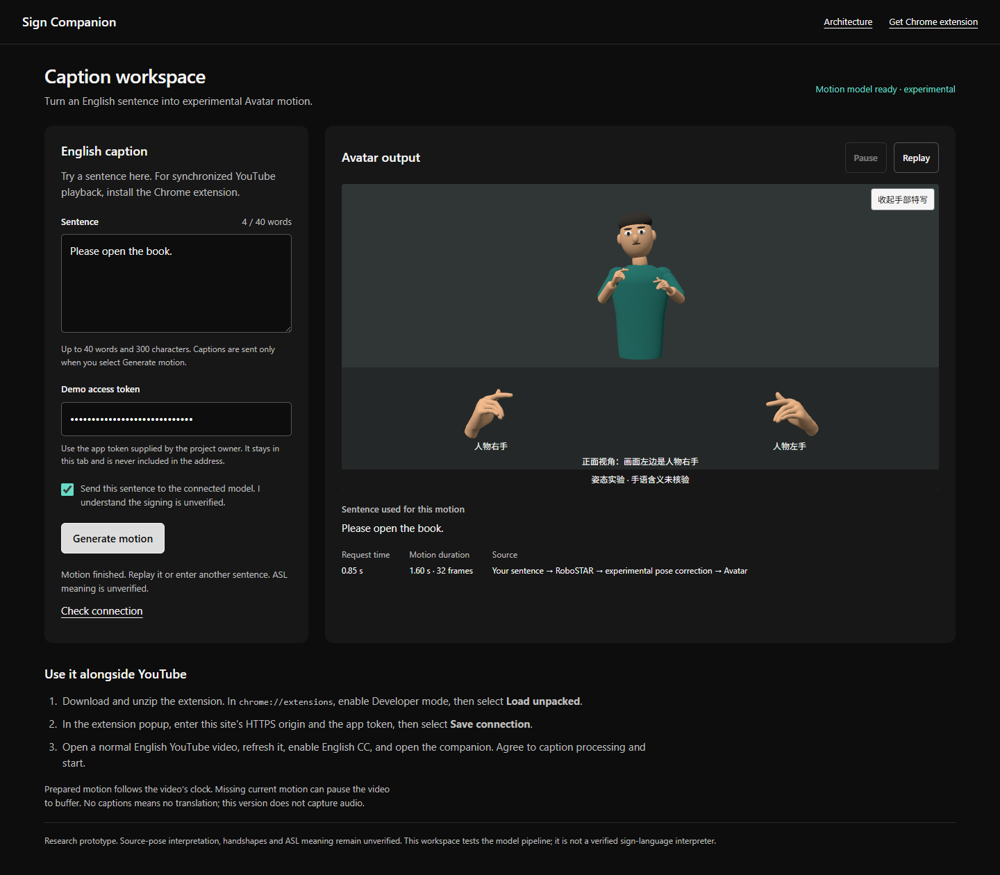
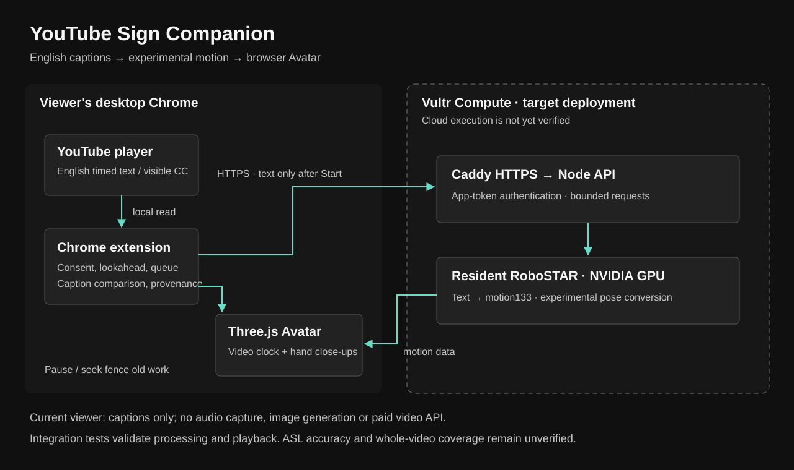

# YouTube Sign Companion

A desktop Chrome prototype that turns English YouTube captions into experimental ASL motion beside the original video. There is no video upload step. The current viewer uses one pipeline: **English captions → RoboSTAR → Three.js Avatar**.

**Status:** local model integration and browser playback work. Handshapes, source-pose interpretation and ASL meaning remain unresolved. This is not a verified sign-language interpreter. Vultr deployment, public URLs and competition acceptance must be verified separately.

## What the prototype does

- Tries to read a complete English caption track when a normal YouTube watch page opens.
- Sends caption text to the model only after the user starts processing and gives consent.
- Prepares upcoming segments within a rolling 30-second window. Prepared motion waits for the source video clock.
- Uses visible English CC when a complete track cannot be read. There is no audio fallback in the current viewer.
- Handles pause, seek, stop and replay. Missing current motion may pause the source video to buffer.
- Shows original captions, the sentence attached to the displayed motion, and the actual input path.
- Renders an upper-body Avatar and synchronized hand close-ups in the viewer's browser.

The separate [caption workspace](public/demo.html) accepts a short sentence for a real authenticated model request. It does not fetch YouTube videos or substitute stored signs. Its download link serves the current sanitized extension package.



[Watch the local product recording](docs/local-product-demo.mp4). It shows actual model calls and is labelled local, with Vultr deployment pending and ASL unverified. See [VALIDATION.md](submission/VALIDATION.md) for the scope of the checks.

## Target users and problem

The intended audience is sign-language users who would like an additional signed view while watching English educational videos. Caption preference, language proficiency and sign-language fluency vary across individuals. This prototype does not assume that all Deaf or hard-of-hearing viewers prefer signing, and no demand-size claim or user-validation result is made.

The project explores the viewing workflow and synchronization problem. A model that produces motion is insufficient evidence that the output communicates the input correctly.

## Architecture



1. **Chrome MV3 extension:** reads English timed-text data, reuses the player's normal caption responses, or reads visible CC. It maintains the video clock and caption queue.
2. **Authenticated Node API:** validates bounded requests and app tokens, serializes local GPU work, and returns motion with provenance.
3. **Resident RoboSTAR worker:** loads pinned pretrained weights, produces motion133, and applies the explicitly experimental pose profile.
4. **Three.js renderer:** applies the motion to a browser Avatar and complete skinned hand assets.
5. **Target cloud deployment:** Caddy terminates HTTPS on Vultr; Node and the model run in a GPU container. This diagram marks the cloud boundary as planned until it is actually verified.

## Local setup

Requirements: Node.js 22+, Python 3.10, desktop Chrome and a compatible NVIDIA CUDA GPU. GPU memory and latency must be measured on the selected machine. Setup downloads roughly 7.3 GB of motion weights plus tokenizer files and a separate CUDA/Python environment.

```bash
npm ci
python3.10 -m venv .venv-motion
.venv-motion/bin/python -m pip install torch==2.5.1 --index-url https://download.pytorch.org/whl/cu124
.venv-motion/bin/python -m pip install -r motion/requirements.txt
git clone https://github.com/zyjOrz/RoboSTAR.git tmp/robostar-src
git -C tmp/robostar-src checkout 2371ba3e7cdd57242b4a96709a977eabc298e940
.venv-motion/bin/python motion/download.py --accept-large-download --directory models
```

Create `.env.local` with a fresh random `APP_TOKEN` and `ENABLE_GENERATION=0`. Create `.env.motion.local` from this example, adapting paths to your operating system:

```dotenv
ENABLE_MOTION=1
MOTION_PYTHON=.venv-motion/bin/python
MOTION_SOURCE_DIR=tmp/robostar-src
MOTION_MODEL_DIR=models/robostar
MOTION_BASE_DIR=models/mt5
MOTION_DTYPE=bf16
MOTION_POSE_PROFILE=experimental-inverse
ENABLE_FRAMEGEN=0
```

On Windows use `.venv-motion\Scripts\python.exe` for Python commands and `MOTION_PYTHON`. Use `float32` when the GPU cannot execute BF16; test available memory and speed. The pose profile is a hypothesis, not a verified repair. It does not require the private SMPL-X reference asset.

```bash
npm start
```

Open `http://127.0.0.1:4318/demo.html`. Wait for `/api/health` to report `motionReady: true`. Enter a sentence, the app token and consent to run the workspace. The token is kept in the page's memory, not stored in localStorage or included in a URL.

### Chrome extension

1. Download and unzip `public/downloads/youtube-sign-companion-extension.zip`, or use the repository's `extension` directory.
2. Open `chrome://extensions`, enable Developer mode and select **Load unpacked**.
3. Open the popup's **后端连接设置** (backend connection settings). Set the backend origin and app token, then **保存后端设置** (save).
4. Refresh a normal English YouTube video and enable English CC.
5. Open **YouTube 伴看面板**, agree to caption processing, then **开始实时翻译**. The action name describes the intended workflow; it does not certify real-time performance or correct ASL.

No captions means no translation. A video's captions, YouTube page changes and browser throttling can affect availability. Keep the original captions visible.

## Vultr deployment

Use [the caption-only deployment guide](submission/DEPLOYMENT.md) and `deploy/compose.caption.yaml`. This build does not install Whisper, SD-Turbo or a server-side frame-rendering browser. Historical experiments remain in the workspace but are excluded from the current user workflow.

You need a deployable GPU instance, sufficient account cost limits, a domain you control, and confirmation that your credits cover the selected service. A credit balance does not override instance-cost limits. No claim is made that the prepared image has passed a real Vultr run until cloud evidence is added.

## Validation and limits

Run `npm test` for API authentication, request bounds, queue behavior, caption ingestion, renderer contracts and related regressions. Run the Python motion tests with the configured Python environment. Browser checks use clearly labelled controlled pages and are separate from live YouTube compatibility and linguistic validation.

`scripts/submission-browser-check.mjs` expects the local resident model at port 4318. It creates an authenticated loopback proxy on 4324 for its own checks, runs actual inference and records the workspace. It does not start a second GPU model or call a paid API. Its model-unavailable state is a deliberate fixture; generated motion requests use the real local model.

Known limitations:

- Source-pose interpretation, handshapes, facial grammar and ASL meaning have not been validated with fluent ASL users. Some generated motion is visibly implausible.
- No reliable arbitrary-video translation, whole-video coverage, zero-latency playback or multi-user capacity is claimed.
- Timestamp interpolation is not linguistic word alignment.
- Captions and an app token are required. The current public demo is an authenticated evaluation workspace.
- The public release excludes weights, private reference models, local credentials, browser profiles and participant emails.

## Credits and licensing

See [THIRD_PARTY.md](submission/THIRD_PARTY.md). Pretrained model and asset terms apply separately. This project does not redistribute RoboSTAR weights, a private SMPL-X model, YouTube footage or Signapse output. Third-party license notices are included with the bundled runtime assets. No claim of independently training the motion model is made.

## Submission status

The material is prepared for **HackGlobal 2026 · Multimodal and accessibility**. A repository ZIP, local recording and deployment recipe are preparation artifacts, not proof of a public repository, cloud deployment or accepted competition submission. See [STATUS.md](submission/STATUS.md) for the exact remaining items.
